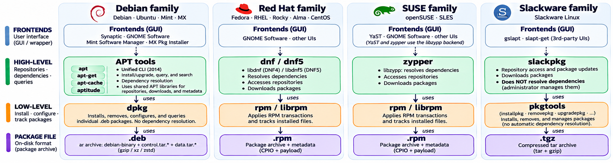

# System Package Managers

## What Is a System Package Manager?

A **system package manager** is a tool that automates **installing**, **upgrading**, **configuring**, and **removing** software on an operating system. It downloads prebuilt software from central **repositories** and handles **dependencies**, which means it also installs any libraries or components the software needs to run.

Most operating systems have one or more package managers, either built in or available from third parties:

- **Linux** distributions include one by default, such as `apt`, `dnf`, `zypper`, or `pacman`.
- **macOS** does not include one, but third-party tools such as Homebrew and MacPorts are widely used.
- **Windows** includes `winget`, and third-party tools such as Chocolatey and Scoop are also available.
- **FreeBSD** includes `pkg` for binary packages and the Ports collection for building from source.

Each of these is covered in more detail below.

> **System vs. language-specific package managers:** System package managers install operating system software such as applications, services, drivers, and shared libraries. **Language-specific** package managers such as `pip` (Python), `npm` (Node.js), `gem` (Ruby), and `cargo` (Rust) install libraries for one programming language, usually for a single project or user.

## Package Management on Linux

The **Linux kernel** is the core of the operating system. It manages hardware, processes, memory, and filesystems, but it does **not** include a package manager. Package management happens in **userspace**, meaning it is done by ordinary programs that run on top of the kernel. Each Linux distribution chooses its own:

- **Package format**: the file format used to bundle software (for example, `.deb` or `.rpm`).
- **Package manager**: the tool that installs, upgrades, and removes packages.
- **Repository infrastructure**: the servers and metadata that host and describe the packages.

This is why Linux distributions can use completely different package managers even though they all run the same kernel. For a broader overview of Linux distributions, see [Linux Distributions](https://github.com/ManiAm/linux-kernel/blob/master/docs/04_linux_distributions.md).

### Base Distributions

A **base distribution** is built independently rather than from another distribution. It has its own package manager, package format, and release infrastructure, and it serves as the foundation for a family of derivative distributions.

| Base Distribution | Year | Package Manager          | Package Format  |
|-------------------|------|--------------------------|-----------------|
| Slackware         | 1993 | pkgtools                 | `.txz`          |
| Debian            | 1993 | APT / dpkg               | `.deb`          |
| SUSE Linux        | 1994 | Zypper / RPM             | `.rpm`          |
| Red Hat Linux     | 1994 | DNF (formerly YUM) / RPM | `.rpm`          |
| Arch Linux        | 2002 | Pacman                   | `.pkg.tar.zst`  |
| Gentoo            | 2002 | Portage (`emerge`)       | Source (ebuild) |
| NixOS             | 2003 | Nix                      | Nix store paths |

> **Note:** The package managers listed are the ones these families use today. Some were introduced later; for example, SUSE adopted Zypper in 2007, and Red Hat-based systems replaced YUM with DNF starting in 2015.

### Derivative Distributions

Most Linux distributions are **derived** from a base distribution (or from another derivative). They inherit the parent's package manager, package format, and core infrastructure, and add their own customizations on top.

| Derivative      | Year | Base Family         | Use Case                                                                    |
|-----------------|------|---------------------|-----------------------------------------------------------------------------|
| Ubuntu          | 2004 | Debian              | General-purpose desktop and server.                                         |
| Linux Mint      | 2006 | Debian (via Ubuntu) | Beginner-friendly desktop with a familiar layout.                           |
| Kali Linux      | 2013 | Debian              | Penetration testing and security auditing.                                  |
| openSUSE        | 2005 | SUSE                | Community desktop and server distribution.                                  |
| RHEL            | 2002 | Red Hat             | Commercial enterprise distribution with paid support.                       |
| Fedora          | 2003 | Red Hat             | Fast-moving desktop and developer platform.                                 |
| CentOS          | 2004 | Red Hat (via RHEL)  | Free RHEL rebuild; discontinued (final release ended in 2024) and replaced by CentOS Stream. |
| Rocky Linux     | 2021 | Red Hat (via RHEL)  | Community-run, RHEL-compatible replacement for CentOS.                      |
| AlmaLinux       | 2021 | Red Hat (via RHEL)  | Community-run, RHEL-compatible replacement for CentOS.                      |
| Manjaro         | 2011 | Arch                | User-friendly Arch derivative with tested, delayed updates.                 |
| EndeavourOS     | 2019 | Arch                | Close-to-Arch experience with a graphical installer.                        |
| Calculate Linux | 2007 | Gentoo              | Preconfigured Gentoo for desktops and servers.                              |

Every one of these derivatives uses **the same package format and core package manager** as its parent. This is a practical requirement, not just a convention:

1. **Packages are built for one format.** Debian's repositories contain tens of thousands of `.deb` packages, and Red Hat's contain `.rpm` packages. A derivative cannot natively install packages in a different format.
2. **Repository infrastructure is format-specific.** Repository servers, metadata indexes, dependency resolvers, and mirror networks are all designed around a single format.
3. **Build tools produce one format.** The toolchains that compile and package software, such as `debuild`/`pbuilder` for Debian and `rpmbuild`/`mock` for Red Hat, output only their own format.
4. **Installation scripts are incompatible.** Debian packages use `preinst`/`postinst`/`prerm`/`postrm` scripts, while RPM packages use `%pre`/`%post`/`%preun`/`%postun` scriptlets.
5. **The OS installer depends on the package manager.** Debian's `debootstrap` builds the initial system from `.deb` packages, and Red Hat's Anaconda installer builds it from `.rpm` packages using DNF.

Switching package managers would mean rebuilding **every package** from scratch, which would effectively create a new base distribution rather than a derivative.

> **Rare exceptions are full rebases, not swaps.** A few distributions have changed their base entirely, and their package manager changed as a result:
>
> - **Slax** started in 2002 as a Slackware derivative using pkgtools. In 2017 it was rebuilt on Debian and switched to APT/dpkg.
> - **SteamOS** versions 1.0 and 2.0 (2013–2015) were based on Debian and used APT. SteamOS 3.0 (2022), made for the Steam Deck, was rebuilt on Arch Linux and switched to Pacman.
>
> In both cases, the package manager changed because the whole foundation changed.

### Other Independent Distributions

A few distributions do not belong to any of the families above and use their own package managers:

| Distribution    | Year | Package Manager | Description                                                                   |
|-----------------|------|-----------------|-------------------------------------------------------------------------------|
| Puppy Linux     | 2003 | PPM             | Very lightweight distribution for older hardware. Modern releases are built from Ubuntu or Slackware packages but use Puppy's own package manager. |
| Alpine Linux    | 2005 | APK             | Minimal, security-focused distribution widely used as a base for containers.  |
| Void Linux      | 2008 | XBPS            | Lightweight distribution with its own package manager and the runit init system. |
| Tiny Core Linux | 2008 | `tce-load`      | Extremely small distribution; the base system is under 20 MB.                 |
| Clear Linux     | 2015 | `swupd`         | Performance-optimized distribution from Intel; discontinued in July 2025.     |

## Package Manager Architectures

Linux package managers follow one of two designs: a **two-layer architecture**, which splits the work between two tools, or a **single-tool architecture**, which does everything in one program.

### Two-Layer Architecture

In a two-layer system:

- A **low-level tool** installs, removes, and queries individual package files that are already on the system. It does not download packages or resolve dependencies.

- A **high-level tool** works with repositories: it finds packages, resolves dependencies, downloads the required files, and then calls the low-level tool to install them.

| Family    | Low-Level  | High-Level                                | Notes                                                                                            |
|-----------|------------|-------------------------------------------|--------------------------------------------------------------------------------------------------|
| Debian    | `dpkg`     | `apt`, `apt-get`, `apt-cache`, `aptitude` | All APT tools share the same libraries for repository access, dependency resolution, and downloads. |
| Red Hat   | `rpm`      | `dnf` (`dnf5` in newer releases)          | `dnf` resolves dependencies with `libdnf` and uses RPM to install packages.                      |
| SUSE      | `rpm`      | `zypper`                                  | `zypper` resolves dependencies with `libzypp` and uses RPM to install packages.                  |
| Slackware | `pkgtools` | `slackpkg`                                | `slackpkg` downloads packages and calls `pkgtools`, but intentionally does **not** resolve dependencies; that is left to the administrator. |

For example, when you run `apt install vim`, `apt` resolves the dependencies of `vim`, downloads all required `.deb` files from the repository, and then calls `dpkg` to install them. `dnf install vim` works the same way, using `rpm` for the final installation step.

This split lets the high-level tool offer convenient features (searching repositories, resolving dependencies, upgrading the whole system) while the low-level tool stays small and focused on handling package files.

### Single-Tool Architecture

Other distributions use one integrated tool for repository access, dependency resolution, and installation.

| Distribution    | Package Manager       | Notes                                                                                 |
|-----------------|-----------------------|---------------------------------------------------------------------------------------|
| Arch Linux      | `pacman`              | Handles repositories, dependencies, and installation; built on the `libalpm` library. |
| Gentoo          | Portage (`emerge`)    | Downloads source code, compiles it with user-selected options, and installs the result. |
| NixOS           | Nix (`nix`)           | Stores each package in its own isolated path, enabling atomic upgrades and rollbacks. |
| Alpine Linux    | `apk`                 | Fast, lightweight tool that manages packages from a declared list of required packages. |
| Void Linux      | XBPS (`xbps-install`) | Suite of small tools built on the `libxbps` library.                                  |
| Puppy Linux     | PPM                   | Graphical tool for browsing repositories, resolving dependencies, and installing packages. |
| Tiny Core Linux | `tce-load`            | Loads SquashFS extensions and their dependencies, which are listed in `.dep` files.   |
| Clear Linux     | `swupd`               | Installs software as "bundles" and updates and verifies the whole OS as one unit.     |

## Wrappers and Frontends

Many distributions and communities provide **wrappers** and **graphical frontends** that make package management easier. These tools do not replace the system package manager; they call it (or its libraries) behind the scenes.

### Distribution-Specific Wrappers

These tools are developed by a specific distribution for its own users:

| Wrapper              | Type    | Distribution   | Base Family | Uses                          | Description                                                   |
|----------------------|---------|----------------|-------------|-------------------------------|---------------------------------------------------------------|
| Software Manager     | GUI     | Linux Mint     | Debian      | APT, Flatpak                  | Curated graphical tool for browsing and installing software.  |
| AppCenter            | GUI     | elementary OS  | Debian      | Flatpak, PackageKit (APT)     | Curated app store; apps come from Flatpak, and system updates go through APT. |
| MX Package Installer | GUI     | MX Linux       | Debian      | APT, Flatpak                  | Simplified graphical package installer.                       |
| YaST                 | GUI/TUI | openSUSE, SLES | SUSE        | `libzypp` (RPM)               | Full system administration tool; uses the same `libzypp` library as `zypper`. |
| Pamac                | GUI/CLI | Manjaro        | Arch        | `libalpm` (Pacman)            | Graphical and command-line manager with AUR, Flatpak, and Snap support. |

### Cross-Distribution Wrappers

These tools can be installed on many distributions:

| Wrapper        | Type        | Works On                      | Uses                                   | Description                                                        |
|----------------|-------------|-------------------------------|----------------------------------------|--------------------------------------------------------------------|
| PackageKit     | Daemon/API  | Most major distributions      | APT, DNF, Zypper, and others           | Common interface that lets graphical tools work with any supported package manager. |
| GNOME Software | GUI         | GNOME desktops (Ubuntu, Fedora, and others) | PackageKit, Flatpak, Snap | Graphical app store for the GNOME desktop.                         |
| KDE Discover   | GUI         | KDE Plasma desktops           | PackageKit, Flatpak, Snap              | Graphical app store for the KDE Plasma desktop.                    |
| Synaptic       | GUI         | Debian-based distributions    | APT                                    | Feature-rich graphical package manager with advanced filtering and search. |
| `yay`          | CLI         | Arch-based distributions      | `pacman`, `makepkg`                    | Popular helper for building and installing packages from the Arch User Repository (AUR). |
| `paru`         | CLI         | Arch-based distributions      | `pacman`, `makepkg`                    | AUR helper written in Rust, with commands similar to `yay`.        |

## Package Formats

A **package format** defines how a program's files, metadata (name, version, dependencies), and installation scripts are bundled together. Each format belongs to a specific package management ecosystem.

### Native Package Formats

| Format                         | Used By                                  | Description                                                              |
|--------------------------------|------------------------------------------|--------------------------------------------------------------------------|
| **TXZ** (`.txz`, `.tgz`)       | Slackware                                | Compressed tar archive with minimal metadata.                            |
| **DEB** (`.deb`)               | Debian, Ubuntu, and derivatives          | Binary package managed by `dpkg` and APT.                                |
| **RPM** (`.rpm`)               | Red Hat, Fedora, SUSE, and derivatives   | Binary package managed by `rpm`, DNF, and Zypper.                        |
| **Ebuild** (`.ebuild`)         | Gentoo                                   | Build script that tells Portage how to compile and install a package from source. |
| **Pacman package** (`.pkg.tar.zst`) | Arch Linux and derivatives          | Compressed tar archive installed by `pacman`.                            |
| **PKGBUILD**                   | Arch Linux and derivatives               | Build script used by `makepkg` to create `.pkg.tar.zst` packages; also the format used by the AUR. |
| **Nix expression** (`.nix`)    | NixOS and Nix users                      | Declarative build description that Nix uses to build or download a package. |
| **PET** (`.pet`) and **SFS** (`.sfs`) | Puppy Linux                       | `.pet` is a lightweight package archive; `.sfs` is a SquashFS module for larger software sets. |
| **APK** (`.apk`)               | Alpine Linux                             | Lightweight compressed archive (unrelated to Android `.apk` files).      |
| **TCZ** (`.tcz`)               | Tiny Core Linux                          | SquashFS-based extension that is mounted at runtime.                     |
| **XBPS** (`.xbps`)             | Void Linux                               | Compressed binary package for the XBPS package manager.                  |
| **Bundles**                    | Clear Linux                              | Groups of files that together provide a feature, managed by `swupd` instead of individual package files. |

## Package Managers on Other Operating Systems

### macOS

macOS does **not** include a command-line package manager. Apple distributes applications through the App Store and system updates through Software Update, so the community created its own tools:

| Package Manager | Year | Type          | Description                                                                                         | Example Command               |
|-----------------|------|---------------|-----------------------------------------------------------------------------------------------------|-------------------------------|
| **MacPorts**    | 2002 | Source/binary | Started at Apple as DarwinPorts and inspired by FreeBSD Ports. Uses prebuilt binaries when available and builds from source otherwise. | `sudo port install <package>` |
| **Homebrew**    | 2009 | Binary/source | The most popular macOS package manager. Installs prebuilt binaries ("bottles") by default.          | `brew install <package>`      |

> **Fink** (2000) was the first package manager for macOS and is based on Debian's `dpkg` and APT. It still exists but is rarely used today.

Homebrew also runs on Linux (see [Universal Package Managers](#universal-package-managers)).

### Windows

Windows has traditionally relied on standalone installers (`.exe` and `.msi` files) instead of a central package manager. Several tools now provide command-line package management:

| Package Manager | Year | Maintainer          | Description                                                                                  | Example Command           |
|-----------------|------|---------------------|----------------------------------------------------------------------------------------------|---------------------------|
| **Chocolatey**  | 2011 | Chocolatey Software | The first widely adopted Windows package manager, with a large community package repository. | `choco install <package>` |
| **Scoop**       | 2013 | Community           | Lightweight installer focused on command-line and developer tools; no administrator rights required. | `scoop install <package>` |
| **winget**      | 2020 | Microsoft           | Official Windows package manager, preinstalled on Windows 11 and recent versions of Windows 10. | `winget install <package>` |

### FreeBSD

FreeBSD offers two complementary ways to install software:

| Tool      | Year | Type         | Description                                                                                   | Example Command                     |
|-----------|------|--------------|-----------------------------------------------------------------------------------------------|-------------------------------------|
| **Ports** | 1994 | Source-based | Collection of build recipes that compile software from source with customizable options.      | `cd /usr/ports/<category>/<port> && make install` |
| **pkg**   | 2012 | Binary       | Official binary package manager and the default since FreeBSD 10 (2014). Fast and simple to use. | `pkg install <package>`             |

## Universal Package Managers

Some package managers and app formats work across many Linux distributions, and in some cases across operating systems, independently of the native package manager:

| Tool         | Year | Platforms                              | Type          | Description                                                                                      |
|--------------|------|----------------------------------------|---------------|--------------------------------------------------------------------------------------------------|
| **pkgsrc**   | 1997 | NetBSD, Linux, macOS, Solaris, and more | Source/binary | NetBSD's portable package system, derived from FreeBSD Ports, with more than 20,000 packages for over 20 platforms. |
| **Nix**      | 2003 | Any Linux distribution, macOS          | Binary/source | The NixOS package manager, which can also be installed alongside any native package manager.     |
| **AppImage** | 2004 | Linux                                  | Portable      | Self-contained app file that runs without installation (originally named klik). Not a package manager: you download the file and run it. |
| **Homebrew** | 2009 | macOS, Linux                           | Binary/source | Originally macOS-only; added Linux support in 2019.                                              |
| **Flatpak**  | 2015 | Linux                                  | Sandboxed     | Desktop apps distributed through repositories such as Flathub and run in isolated sandboxes.     |
| **Snap**     | 2016 | Linux                                  | Containerized | Canonical's app format with automatic updates and security confinement, distributed through the Snap Store. |

These tools do not replace the native package manager; they run **alongside** it. The native package manager still handles the operating system, kernel, and core libraries, while universal tools add desktop applications and developer tools.

## Repositories

A **repository** is a server, usually copied to many mirror servers, that hosts software packages along with **metadata** describing each package's name, version, dependencies, and description. When you run a command like `apt install curl`, the package manager:

1. Checks its local copy of the repository metadata (downloaded earlier with a command such as `apt update`).
2. Works out which dependencies are also needed.
3. Downloads the required packages from the repository.
4. Installs them using the low-level package manager.

Repositories are built for a specific distribution **and** release. An Ubuntu `.deb` package cannot be installed on Fedora, which uses `.rpm`, and even a `.deb` built for one Ubuntu release may not work on another Ubuntu release or on Debian, because the library versions it depends on can differ.

### Ubuntu Repositories

Ubuntu organizes its packages into four **components** based on license and support level:

| Component      | Description                                                                         |
|----------------|-------------------------------------------------------------------------------------|
| **Main**       | Free and open-source software officially supported by Canonical.                    |
| **Universe**   | Free and open-source software maintained by the community.                          |
| **Restricted** | Proprietary software, mainly device drivers, officially supported by Canonical.     |
| **Multiverse** | Software with license or legal restrictions; not supported by Canonical.            |

> **Note:** Older Ubuntu releases also offered the **Canonical Partner Repository** for proprietary third-party software. It was discontinued starting with Ubuntu 22.04, and most of that software is now distributed as Snaps.

---

**Next**: [dpkg →](02_dpkg.md)
