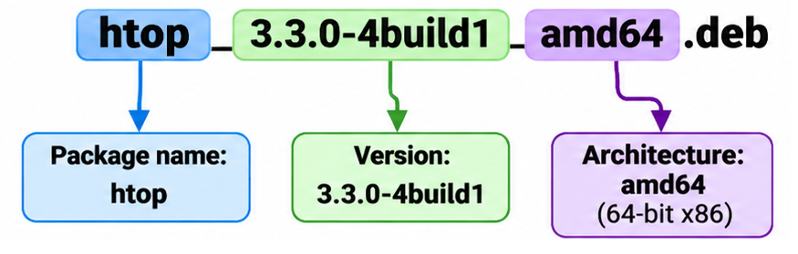
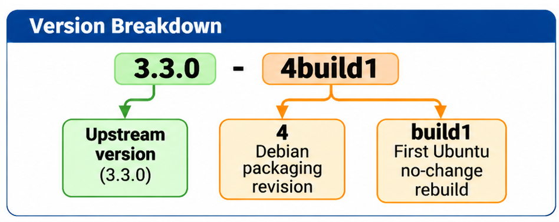
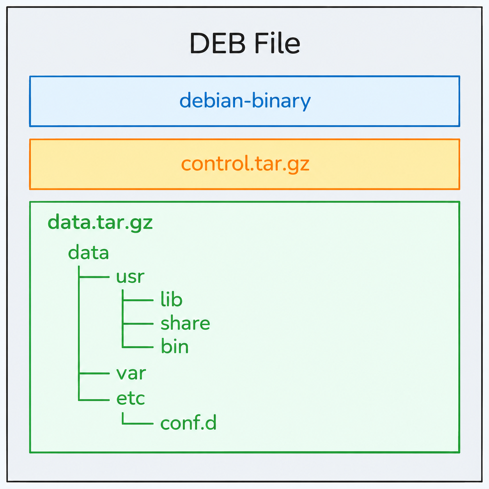
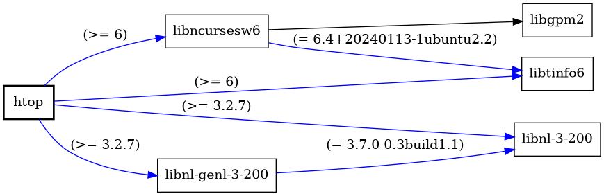
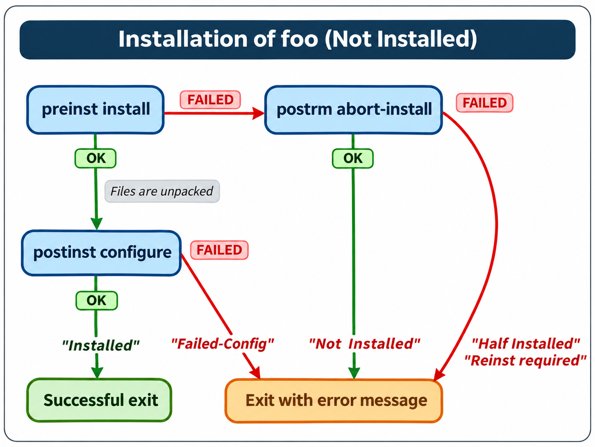

# dpkg — Debian Package Manager

> All examples in this document were captured on **Ubuntu 24.04 LTS (Noble Numbat)**. To follow along, start a container and install the tools used in the examples:
>
> ```
> docker run -it ubuntu:24.04 bash
> apt-get update && apt-get install -y file binutils
> apt-get download bash htop
> ```
>
> This installs `file` (for inspecting file types) and `binutils` (which provides the `ar` tool for extracting archives), then downloads the `bash` and `htop` `.deb` files used throughout the examples. `dpkg` and `dpkg-deb` are already preinstalled. You can ignore the `Download is performed unsandboxed as root` warning — it is normal inside a container.

`dpkg` is the **low-level** package management tool used in Debian-based Linux distributions such as Ubuntu. It installs, removes, and manages individual `.deb` packages that are already on the local filesystem.

Because `dpkg` is a low-level tool, it does **not** resolve dependencies automatically. If a package depends on other packages that are not yet installed, `dpkg` will report an error and leave the package in a broken state. For day-to-day use, a higher-level tool like `apt` is preferred because it handles dependency resolution, downloads, and repository access on your behalf (see [APT](03_apt.md)).

Most Debian-based systems come with `dpkg` preinstalled. You can check its version with:

```
$ dpkg --version
Debian 'dpkg' package management program version 1.22.6 (amd64).
```

Basic syntax:

```
$ dpkg [<option> ...] <command>
```


## `.deb` Naming Convention

`.deb` filenames have **three fields** separated by underscores:

```
<name>_<version>_<architecture>.deb
```

For example:



Common architecture values: `amd64` (64-bit Intel/AMD), `arm64` (64-bit ARM), `i386` (32-bit Intel), `all` (architecture-independent, e.g., scripts or documentation).

### Version Format

The full version of a Debian package is defined by the [Debian Policy](https://www.debian.org/doc/debian-policy/ch-controlfields.html#version) as:

```
[epoch:]upstream_version[-debian_revision]
```

| Component          | Required | Purpose |
|--------------------|----------|---------|
| `epoch`            | Optional | An integer prefix (e.g., `2:`) used when the upstream versioning scheme changes. Higher epoch values always win in version comparisons, regardless of the upstream version number. |
| `upstream_version` | Yes      | The version of the original upstream software. |
| `debian_revision`  | Optional | The revision of the Debian packaging. Incremented when the packaging changes but the upstream source does not. Separated from the upstream version by the **last hyphen** in the string. |

For example:



The `<version>` field in the **filename** excludes the epoch because colons are not allowed in filenames on many filesystems.

If the `debian_revision` is absent (no hyphen in the version), the package is a **native** Debian package — one that exists only as a Debian package and has no separate upstream source.

> **Comparison with RPM:** RPM filenames use **hyphens** as separators and have `Version` and `Release` as two genuinely separate header fields. In `.deb` files, the revision is part of the single `Version` field, and the filename uses **underscores** to separate its three fields.


## The `.deb` Package File

A `.deb` package is an **`ar` archive** — `ar` is a traditional Unix archiving tool, similar in concept to `tar` or `zip`. Each `.deb` archive contains three components:



You can verify the format with the `file` command:

```
$ file bash_5.2.21-2ubuntu4_amd64.deb
bash_5.2.21-2ubuntu4_amd64.deb: Debian binary package (format 2.0), with control.tar.zst, data compression zst
```

You can extract the archive using the `ar` command:

```
$ ar vx bash_5.2.21-2ubuntu4_amd64.deb
x - debian-binary
x - control.tar.zst
x - data.tar.zst
```

The three extracted files are:

- **`debian-binary`** — A small text file containing the Debian package format version (typically `2.0`). This tells `dpkg` how to process the archive.

- **`control.tar.{gz,zst}`** — Contains package metadata and maintainer scripts. Modern packages (Ubuntu 24.04+) use Zstandard (`.zst`) compression; older packages use gzip (`.gz`):

    | File        | Purpose                                            |
    |-------------|----------------------------------------------------|
    | `control`   | Package description (name, version, dependencies). |
    | `conffiles` | Lists files that `dpkg` should treat as configuration files (see [Configuration File Handling](#configuration-file-handling)). |
    | `md5sums`   | MD5 checksums for every installed file, used by `dpkg --verify` to detect modifications. |
    | `preinst`   | Script executed **before** installation.           |
    | `postinst`  | Script executed **after** installation.            |
    | `prerm`     | Script executed **before** removal.                |
    | `postrm`    | Script executed **after** removal.                 |

    Some packages also include `triggers` (for coordinating actions across packages), `shlibs`, or `symbols` (for declaring shared library dependencies). These are primarily used by the packaging build system and are not covered here.

- **`data.tar.{gz,zst}`** — Contains the actual files that will be installed on the system. The directory structure inside the archive mirrors the filesystem layout (e.g., `/usr/bin/`, `/etc/`).

### Dependency Fields

The `control` file declares several levels of dependency:

| Field          | Meaning |
|----------------|---------|
| `Pre-Depends`  | Must be fully installed **before** this package is unpacked. Stricter than `Depends`. |
| `Depends`      | Must be installed for this package to function. Installed alongside it. |
| `Recommends`   | Not strictly required, but installed by default by most APT configurations. |
| `Suggests`     | Optional packages that enhance functionality. Not installed by default. |
| `Conflicts`    | Cannot be installed at the same time as this package. |
| `Replaces`     | This package replaces files from the named package. |
| `Breaks`       | This package breaks the named package (forces upgrade or removal). |

You can visualize the dependency tree of a package using `debtree` and `graphviz`:

```
$ apt-get install -y debtree graphviz
$ debtree htop | dot -T png -o htop-deps.png
```



The arrows show version-constrained dependencies (e.g., `htop` depends on `libnl-3-200 >= 3.2.7`). These are the same packages that `dpkg` will complain about if they are missing during installation.


### Inspecting a Package

You can examine a `.deb` file before installing it:

| Command                   | Purpose                                              |
|---------------------------|------------------------------------------------------|
| `dpkg -I <package.deb>`   | Displays the package metadata from `control.tar`.    |
| `dpkg -c <package.deb>`   | Lists the installed files from `data.tar`.           |

Example metadata output — notice that `bash` has `conffiles` and maintainer scripts (`postinst`, `postrm`, `prerm`), confirming what we saw in the `control.tar` table above:

```
$ dpkg -I bash_5.2.21-2ubuntu4_amd64.deb

 new Debian package, version 2.0.
 size 794086 bytes: control archive=1955 bytes.
      77 bytes,     4 lines      conffiles
     975 bytes,    25 lines      control
    1467 bytes,    23 lines      md5sums
     493 bytes,    24 lines   *  postinst             #!/bin/bash
     216 bytes,     5 lines   *  postrm               #!/bin/sh
     289 bytes,    22 lines   *  prerm                #!/bin/bash
 Package: bash
 Version: 5.2.21-2ubuntu4
 Architecture: amd64
 Essential: yes
 Maintainer: Ubuntu Developers <ubuntu-devel-discuss@lists.ubuntu.com>
 Installed-Size: 1900
 Pre-Depends: libc6 (>= 2.38), libtinfo6 (>= 6)
 Depends: base-files (>= 2.1.12), debianutils (>= 5.6-0.1)
 Recommends: bash-completion
 Suggests: bash-doc
 Section: shells
 Priority: required
 Homepage: http://tiswww.case.edu/php/chet/bash/bashtop.html
 Description: GNU Bourne Again SHell
  Bash is an sh-compatible command language interpreter that executes
  commands read from the standard input or from a file.  Bash also
  incorporates useful features from the Korn and C shells (ksh and csh).
```

Example file listing — notice how the paths mirror the filesystem layout, including configuration files under `./etc/`:

```
$ dpkg -c bash_5.2.21-2ubuntu4_amd64.deb

drwxr-xr-x root/root         0 2024-03-31 08:41 ./
drwxr-xr-x root/root         0 2024-03-31 08:41 ./etc/
-rw-r--r-- root/root      2319 2024-03-31 08:41 ./etc/bash.bashrc
drwxr-xr-x root/root         0 2024-03-31 08:41 ./etc/skel/
-rw-r--r-- root/root       220 2024-03-31 08:41 ./etc/skel/.bash_logout
-rw-r--r-- root/root      3771 2024-03-31 08:41 ./etc/skel/.bashrc
-rw-r--r-- root/root       807 2024-03-31 08:41 ./etc/skel/.profile
drwxr-xr-x root/root         0 2024-03-31 08:41 ./usr/
drwxr-xr-x root/root         0 2024-03-31 08:41 ./usr/bin/
-rwxr-xr-x root/root   1446024 2024-03-31 08:41 ./usr/bin/bash
-rwxr-xr-x root/root      6988 2024-03-31 08:41 ./usr/bin/bashbug
-rwxr-xr-x root/root     14568 2024-03-31 08:41 ./usr/bin/clear_console
lrwxrwxrwx root/root         0 2024-03-31 08:41 ./usr/bin/rbash -> bash
drwxr-xr-x root/root         0 2024-03-31 08:41 ./usr/share/
drwxr-xr-x root/root         0 2024-03-31 08:41 ./usr/share/doc/
drwxr-xr-x root/root         0 2024-03-31 08:41 ./usr/share/doc/bash/
...
```


### Extracting with `dpkg-deb`

`dpkg-deb` is a companion tool that can extract `.deb` package contents:

```
# Extract only the installed files (data.tar)
$ dpkg-deb -x <package.deb> <output-directory>

# Extract everything — files AND control metadata/scripts
$ dpkg-deb -R <package.deb> <output-directory>
```


## Installing a Package

To install a local `.deb` package:

```
$ sudo dpkg -i <package.deb>
```

`dpkg` only works with **local** `.deb` files. If the package is hosted online, you must download it first:

```
$ apt-get download htop
$ sudo dpkg -i htop_3.3.0-4build1_amd64.deb
```

If any dependencies are missing, `dpkg` will report the problem and leave the package in an unconfigured state:

```
Unpacking htop (3.3.0-4build1) ...
dpkg: dependency problems prevent configuration of htop:
 htop depends on libnl-3-200 (>= 3.2.7); however:
  Package libnl-3-200 is not installed.
 htop depends on libnl-genl-3-200 (>= 3.2.7); however:
  Package libnl-genl-3-200 is not installed.
```

`dpkg` itself cannot resolve this — you need a higher-level tool like [APT](03_apt.md) to download and install the missing dependencies automatically.

### Installation Process

The installation of a `.deb` package follows three steps:

1. **Pre-installation script** — Executes the `preinst` script, if present.
2. **File extraction** — Places the package files in their target locations on the filesystem.
3. **Post-installation script** — Executes the `postinst` script to complete setup (e.g., starting services, updating caches).



More details: [Debian Policy Flowcharts](https://www.debian.org/doc/debian-policy/ap-flowcharts.html)

### Installing from a Directory

To install all `.deb` packages in a directory:

```
$ sudo dpkg -i /path/to/directory/*.deb
```

To recursively install from a directory and its subdirectories:

```
$ sudo dpkg -R -i /path/to/directory/
```

### Unpacking Without Configuring

The `--unpack` option extracts and places the package files but does **not** run the post-installation script:

```
$ sudo dpkg --unpack <package.deb>
```

This is useful for debugging or staging an installation before manually configuring it. To complete the configuration afterward:

```
$ sudo dpkg --configure <package-name>
```


## Configuration File Handling

Many packages install **configuration files** — files that store your custom settings, typically located under `/etc/` (e.g., `/etc/nginx/nginx.conf`). These files are listed in the package's `conffiles`.

When a newer version of a package is installed over an existing one, `dpkg` is careful not to overwrite your customizations. The behavior depends on whether you or the package maintainer changed the file:

| Your Copy | New Package Version | What `dpkg` Does |
|---|---|---|
| Unchanged | Unchanged | Keeps the existing file (nothing to do). |
| Unchanged | Updated | Installs the new version silently. |
| Modified | Unchanged | Keeps your modified version. |
| Modified | Updated | **Prompts you** to choose which version to keep. |

When prompted, you see options like:

```
Configuration file '/etc/example.conf'
 ==> Modified (by you or by a script) since installation.
 ==> Package distributor has shipped an updated version.
   What would you like to do about it?

     install the package maintainer's version
     keep the local version currently installed
     show the differences between the versions
     start a new shell to examine the situation
```

This ensures `dpkg` never silently overwrites your custom settings. If you are unsure, choose "show the differences" to review the changes before deciding.

> **Comparison with RPM:** RPM handles this differently — it silently keeps your version and saves the new one as `.rpmnew`, or replaces the file and saves your old one as `.rpmsave`. There is no interactive prompt.


## Removing a Package

To uninstall a package but **keep** its configuration files:

```
$ sudo dpkg -r <package-name>
```

To remove the package **and** its configuration files:

```
$ sudo dpkg --purge <package-name>
```

The difference matters when you plan to reinstall a package later: `-r` preserves your custom settings, while `--purge` gives you a clean slate.


## Reconfiguring a Package

`dpkg-reconfigure` re-runs the configuration scripts for a package that is already installed. This is useful when you want to change settings that were chosen during the original installation:

```
$ sudo dpkg-reconfigure <package-name>
```

Common examples:

```
# Change the system timezone
$ sudo dpkg-reconfigure tzdata

# Regenerate locale settings
$ sudo dpkg-reconfigure locales

# Reconfigure the keyboard layout
$ sudo dpkg-reconfigure keyboard-configuration
```


## Querying Packages

### Listing Installed Packages

```
$ dpkg -l
```

The output has five columns:

| Column | Field          | Description                                                         |
|--------|----------------|---------------------------------------------------------------------|
| 1      | Package State  | Desired action, current status, and error flag (see below).         |
| 2      | Package Name   | The name of the installed package.                                  |
| 3      | Version        | The installed version of the package.                               |
| 4      | Architecture   | The system architecture (e.g., `amd64`, `i386`).                    |
| 5      | Description    | A short description of the package.                                 |

Here is an example output:

```
$ dpkg -l bash
Desired=Unknown/Install/Remove/Purge/Hold
| Status=Not/Inst/Conf-files/Unpacked/halF-conf/Half-inst/trig-aWait/Trig-pend
|/ Err?=(none)/Reinst-required (Status,Err: uppercase=bad)
||/ Name           Version         Architecture Description
+++-==============-===============-============-=================================
ii  bash           5.2.21-2ubuntu4 amd64        GNU Bourne Again SHell
```

### Understanding Package State

The first column encodes up to three characters that together describe the package's state.

**Character 1 — Desired action** (what the user last requested):

| Char | Meaning |
|------|---------|
| `u`  | Unknown |
| `i`  | Install |
| `r`  | Remove  |
| `p`  | Purge   |
| `h`  | Hold    |

**Character 2 — Current status** (actual state on the system):

| Char | Meaning                                         |
|------|-------------------------------------------------|
| `n`  | Not installed                                   |
| `i`  | Installed                                       |
| `c`  | Only configuration files remain (after removal) |
| `u`  | Unpacked but not configured                     |
| `f`  | Half-configured (configuration failed)          |
| `h`  | Half-installed (installation failed)            |
| `w`  | Awaiting trigger processing                     |
| `t`  | Trigger pending                                 |

**Character 3 — Error flag** (blank when everything is normal; a letter such as `R` indicates a reinstallation is needed).

Common state codes you will encounter:

- `ii` — Installed and fully configured (normal, healthy state).
- `rc` — Removed, but configuration files still remain on disk.
- `iU` — Installation was requested, but the package is only unpacked and not yet configured.

### Useful Query Commands

| Command                   | Purpose                                                  |
|---------------------------|----------------------------------------------------------|
| `dpkg -l <package-name>`  | Check if a specific package is installed.                |
| `dpkg -L <package-name>`  | List all files installed by a package.                   |
| `dpkg -s <package-name>`  | Show package status and metadata.                        |
| `dpkg -S /path/to/file`   | Find which package owns a specific file.                 |

Examples:

```
$ dpkg -L bash
/.
/etc
/etc/bash.bashrc
/etc/skel
/etc/skel/.bash_logout
/etc/skel/.bashrc
/etc/skel/.profile
/usr
/usr/bin
/usr/bin/bash
/usr/bin/bashbug
/usr/bin/clear_console
...

$ dpkg -S /usr/bin/bash
bash: /usr/bin/bash
```


## The dpkg Database

`dpkg` maintains a local database at `/var/lib/dpkg/` that tracks the state of every package on the system. The most important files and directories are:

- **`/var/lib/dpkg/status`** — The main status file — one entry per package with its state, version, dependencies, and description. This is what `dpkg -l` and `dpkg -s` read from.

- **`/var/lib/dpkg/available`** — Metadata for packages that are available (populated by APT).

- **`/var/lib/dpkg/info/`** — A directory containing the control files for each installed package — file lists (`.list`), checksums (`.md5sums`), config file declarations (`.conffiles`), and maintainer scripts (`.postinst`, `.prerm`, etc.).

For example, to see the control files `dpkg` stores for the `bash` package:

```
$ ls /var/lib/dpkg/info/bash.*
/var/lib/dpkg/info/bash.conffiles
/var/lib/dpkg/info/bash.list
/var/lib/dpkg/info/bash.md5sums
/var/lib/dpkg/info/bash.postinst
/var/lib/dpkg/info/bash.postrm
/var/lib/dpkg/info/bash.prerm
```

> **Caution:** Never edit these files manually. If the database becomes inconsistent (e.g., after a crash), use `sudo dpkg --configure -a` to attempt to fix any packages left in a broken state.


## `update-alternatives`

`update-alternatives` is a tool in the `dpkg` suite that manages symbolic links for programs where multiple versions may be installed (e.g., different text editors, Java runtimes, or Python interpreters). It lets the system and the user choose which version is the default.

```
$ update-alternatives --get-selections
awk                            auto     /usr/bin/mawk
pager                          auto     /bin/more
rmt                            auto     /usr/sbin/rmt-tar
which                          auto     /usr/bin/which.debianutils
```

To show detailed information about a specific alternative:

```
$ update-alternatives --query <name>
```

Each alternative has an assigned **priority**, typically set by the package maintainer. In **auto mode** (the default), `update-alternatives` selects the alternative with the highest priority. If a higher-priority alternative is installed later, it automatically becomes the new default.

To manually select an alternative:

```
$ sudo update-alternatives --config editor
```

---

**Previous**: [← System Package Managers](01_system_package_managers.md) · **Next**: [APT →](03_apt.md)
