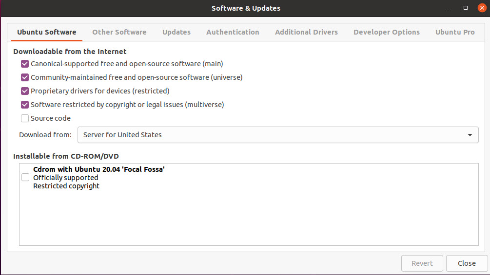

# APT — Advanced Package Tool

> All examples in this document were captured on **Ubuntu 24.04 LTS (Noble Numbat)**. To follow along, start a container:
>
> ```
> docker run -it ubuntu:24.04 bash
> ```
>
> `apt` and `apt-get` are already preinstalled. Run `apt update` as your first command to refresh the package index.

APT is the **high-level** package management system used in Debian, Ubuntu, and related Linux distributions. It downloads packages from remote repositories, resolves dependencies automatically, and then calls [dpkg](02_dpkg.md) to perform the actual installation or removal.

APT originated as part of the Debian project in the late 1990s. Before APT, users had to manually download `.deb` files and resolve dependencies by hand with `dpkg`. APT automated this entire process, making it practical to install complex software with a single command.


## Basic Workflow

The most common APT workflow has three steps:

**1. Update the package index** — Download the latest list of available packages from all configured repositories:

```
$ sudo apt update

Hit:1 http://archive.ubuntu.com/ubuntu noble InRelease
Hit:2 http://security.ubuntu.com/ubuntu noble-security InRelease
Hit:3 http://archive.ubuntu.com/ubuntu noble-updates InRelease
Hit:4 http://archive.ubuntu.com/ubuntu noble-backports InRelease
Reading package lists... Done
Building dependency tree... Done
Reading state information...
4 packages can be upgraded. Run 'apt list --upgradable' to see them.
```

This does **not** install or upgrade anything. It only refreshes APT's local copy of what is available and at what version.

**2. Install a package** — Download and install a package along with all its dependencies:

```
$ sudo apt install <package-name>
```

Example:

```
$ sudo apt install htop

Reading package lists... Done
Building dependency tree... Done
The following additional packages will be installed:
  libnl-3-200 libnl-genl-3-200
The following NEW packages will be installed:
  htop libnl-3-200 libnl-genl-3-200
0 upgraded, 3 newly installed, 0 to remove and 4 not upgraded.
Need to get 239 kB of archives.
```

Notice that APT automatically resolved the dependencies (`libnl-3-200`, `libnl-genl-3-200`) and will install them alongside `htop`. This is the key advantage over using `dpkg` directly.

**3. Upgrade installed packages** — Upgrade all installed packages to their latest available versions:

```
$ sudo apt upgrade
```

APT will show a summary of what will be upgraded and ask for confirmation before proceeding.

> **Key distinction:** `apt update` refreshes the package *index* (the list of what's available). `apt upgrade` installs newer *versions* of packages you already have. You typically run `update` first, then `upgrade`.


## Searching and Inspecting Packages

To find a package by name or description (this searches the local package index downloaded by `apt update`, not remote servers):

```
$ apt search "process viewer"

Sorting...
Full Text Search...
gnome-system-monitor/noble 46.0-1build1 amd64
  Process viewer and system resource monitor for GNOME

htop/noble,now 3.3.0-4build1 amd64 [installed]
  interactive processes viewer

mate-system-monitor/noble 1.26.3-1build3 amd64
  Process viewer and system resource monitor for MATE
...
```

To view detailed information about a specific package:

```
$ apt show htop

Package: htop
Version: 3.3.0-4build1
Priority: optional
Section: utils
Origin: Ubuntu
Maintainer: Ubuntu Developers <ubuntu-devel-discuss@lists.ubuntu.com>
Installed-Size: 434 kB
Depends: libc6 (>= 2.38), libncursesw6 (>= 6), libnl-3-200 (>= 3.2.7), libnl-genl-3-200 (>= 3.2.7), libtinfo6 (>= 6)
Suggests: lm-sensors, lsof, strace
Homepage: https://htop.dev/
Download-Size: 171 kB
APT-Sources: http://archive.ubuntu.com/ubuntu noble/main amd64 Packages
Description: interactive processes viewer
```

To list all installed packages:

```
$ apt list --installed
```

To check which packages have available upgrades:

```
$ apt list --upgradable

Listing...
libc-bin/noble-updates,noble-security 2.39-0ubuntu8.12 amd64 [upgradable from: 2.39-0ubuntu8.9]
libc6/noble-updates,noble-security 2.39-0ubuntu8.12 amd64 [upgradable from: 2.39-0ubuntu8.9]
libsystemd0/noble-updates 255.4-1ubuntu8.19 amd64 [upgradable from: 255.4-1ubuntu8.18]
libudev1/noble-updates 255.4-1ubuntu8.19 amd64 [upgradable from: 255.4-1ubuntu8.18]
```


## `apt` vs `apt-get`

APT provides two main command-line interfaces:

| Tool      | Year | Intended Use             | Key Differences |
|-----------|------|--------------------------|-----------------|
| `apt`     | 2014 | Interactive terminal use | Combines common `apt-get` and `apt-cache` operations, progress bar, color output. |
| `apt-get` | 1998 | Scripting and automation | Stable output format, more granular options, backward-compatible. |

Both tools use the same libraries and call `dpkg` under the hood. The difference is in the user interface, not the underlying behavior. For scripts and automation, `apt-get` is preferred because its output format is guaranteed to remain stable. For everyday terminal use, `apt` is simpler and more readable.

### `apt` Command Reference

The following table maps each `apt` command to its `apt-get` or `apt-cache` equivalent:

| Command | Equivalent | Purpose |
|---------|------------|---------|
| `apt update` | `apt-get update` | Refreshes the local package index. |
| `apt install <package>` | `apt-get install <package>` | Installs a package and its dependencies. |
| `apt remove <package>` | `apt-get remove <package>` | Removes a package (keeps configuration files). |
| `apt purge <package>` | `apt-get purge <package>` | Removes a package and its configuration files. |
| `apt upgrade` | `apt-get upgrade` | Upgrades all installed packages. |
| `apt full-upgrade` | `apt-get dist-upgrade` | Upgrades packages, resolving dependency changes (may remove packages). |
| `apt autoremove` | `apt-get autoremove` | Removes packages that were installed as dependencies and are no longer needed. |
| `apt search <term>` | `apt-cache search <term>` | Searches package names and descriptions. |
| `apt show <package>` | `apt-cache show <package>` | Displays detailed metadata for a package. |
| `apt list --installed` | `dpkg -l` | Lists installed packages. |
| `apt list --upgradable` | *(no direct equivalent)* | Lists packages with available upgrades. |
| `apt edit-sources` | *(no direct equivalent)* | Opens the sources file in a text editor with syntax checking. |

### `apt-get` Reference

`apt-get` supports additional operations beyond what `apt` covers:

| Group                  | Subcommand     | Description                                                              |
|------------------------|----------------|--------------------------------------------------------------------------|
| **Package Management** | `install`      | Installs packages and their dependencies.                                |
|                        | `upgrade`      | Upgrades installed packages to the newest available versions.            |
|                        | `dist-upgrade` | Upgrades packages, resolving dependency changes and handling removals.   |
|                        | `remove`       | Removes a package but leaves its configuration files.                    |
|                        | `purge`        | Removes a package and its configuration files.                           |
|                        | `autoremove`   | Removes packages that were installed as dependencies and are no longer needed. |
| **Index Management**   | `update`       | Downloads the latest package index from all configured repositories.     |
| **Cache Management**   | `clean`        | Deletes all downloaded `.deb` files from the local cache.                |
|                        | `autoclean`    | Deletes only outdated `.deb` files from the cache.                       |
| **Troubleshooting**    | `check`        | Verifies the integrity of installed packages and checks for broken dependencies. |
|                        | `install -f`   | Attempts to fix broken dependencies by installing missing packages.      |
| **Source Management**  | `source`       | Downloads the source code of a package.                                  |
|                        | `build-dep`    | Installs the dependencies required to build a package from source.       |
|                        | `download`     | Downloads a `.deb` file without installing it.                           |
| **Information**        | `changelog`    | Displays the changelog of a package from the repository.                 |

### Other APT Tools

Beyond `apt` and `apt-get`, the APT suite includes several specialized tools:

| Tool                   | Purpose                                       | Common Use Case                                             |
|------------------------|-----------------------------------------------|-------------------------------------------------------------|
| `apt-cache`            | Querying package metadata                     | Searching for packages, viewing dependencies, and checking details. |
| `apt-mark`             | Managing package installation states          | Marking packages as manually or automatically installed, holding versions. |
| `apt-config`           | Viewing APT configuration settings            | Inspecting or debugging APT configuration.                  |
| `apt-cdrom`            | Adding CD-ROMs as APT sources                 | Adding software sources from physical media (rare today).   |
| `apt-ftparchive`       | Creating repository index files               | Generating `Packages` and `Sources` files for custom repositories. |
| `apt-sortpkgs`         | Sorting package index files                   | Organizing package lists for faster access.                 |
| `apt-extracttemplates` | Extracting configuration templates            | Preparing configuration questions for package installation. |

> **Note:** `apt-key` was previously used to manage GPG keys for repository authentication. It has been **deprecated** since APT 2.4 (Ubuntu 22.04) and should no longer be used. See [Repository Authentication](#repository-authentication) below for the modern approach.


## Holding Packages

Sometimes you want to prevent a specific package from being upgraded — for example, to keep a known-working kernel version or avoid a buggy update. APT calls this **holding** a package.

```
# Prevent a package from being upgraded
$ sudo apt-mark hold <package-name>

# Resume normal upgrades for the package
$ sudo apt-mark unhold <package-name>

# List all held packages
$ apt-mark showhold
```

When a package is held, `apt upgrade` will skip it and report it as "kept back."


## Automatic vs Manual Packages

APT tracks whether each package was installed **manually** (you explicitly asked for it) or **automatically** (it was pulled in as a dependency). When you run `apt autoremove`, APT removes automatic packages that are no longer needed by any manually installed package.

```
# Mark a package as manually installed (prevent autoremove from removing it)
$ sudo apt-mark manual <package-name>

# Mark a package as automatically installed
$ sudo apt-mark auto <package-name>

# List automatically installed packages
$ apt-mark showauto
```


## Repository Configuration

### `sources.list`

The file `/etc/apt/sources.list` tells APT where to download packages from. Each line specifies one repository source in this format:

```
<type> <URI> <distribution> <component> [<component> ...]
```

| Field              | Description |
|--------------------|-------------|
| `<type>`           | `deb` for binary packages (precompiled), `deb-src` for source packages. |
| `<URI>`            | URL or path to the repository (e.g., `http://`, `https://`, or `file://`). |
| `<distribution>`   | Release codename (e.g., `noble`, `bookworm`) or suite name (`stable`, `testing`). |
| `<component>`      | Sections of the repository (e.g., `main`, `restricted`, `universe`, `multiverse`). |

Example — the traditional one-line format:

```
deb http://archive.ubuntu.com/ubuntu/ noble main restricted universe multiverse
deb http://archive.ubuntu.com/ubuntu/ noble-updates main restricted universe multiverse
deb http://security.ubuntu.com/ubuntu/ noble-security main restricted universe multiverse
```

The first line provides the initial release packages, the second provides post-release updates, and the third provides security patches.

### `sources.list.d/`

Rather than editing `sources.list` directly, third-party repositories should be added as individual files in `/etc/apt/sources.list.d/`. This keeps the system repository configuration separate from additions and makes it easy to add or remove a repository by adding or deleting a single file.

```
$ ls /etc/apt/sources.list.d/
ubuntu.sources
```

### DEB822 Format

Starting with Ubuntu 24.04, the default system repository uses the newer **DEB822** multi-line format (named after the RFC 822 email header style) in `/etc/apt/sources.list.d/ubuntu.sources` instead of the traditional one-line `sources.list`:

```
$ cat /etc/apt/sources.list.d/ubuntu.sources
Types: deb
URIs: http://archive.ubuntu.com/ubuntu/
Suites: noble noble-updates noble-backports
Components: main universe restricted multiverse
Signed-By: /usr/share/keyrings/ubuntu-archive-keyring.gpg

Types: deb
URIs: http://security.ubuntu.com/ubuntu/
Suites: noble-security
Components: main universe restricted multiverse
Signed-By: /usr/share/keyrings/ubuntu-archive-keyring.gpg
```

The DEB822 format is more readable and supports the `Signed-By` field natively. Both formats work side by side; APT reads both.

### Adding a Third-Party Repository

On Ubuntu, the easiest way to add a third-party repository is with `add-apt-repository`, which handles the repository source and signing key in one step:

```
# Add a PPA (Personal Package Archive)
$ sudo add-apt-repository ppa:deadsnakes/ppa
$ sudo apt update
$ sudo apt install python3.12
```

To add a repository manually, create a file in `sources.list.d/` and import its GPG signing key:

```
# Download the signing key
$ curl -fsSL https://example.com/repo-key.gpg | sudo gpg --dearmor -o /usr/share/keyrings/example.gpg

# Add the repository with the key reference
$ echo "deb [signed-by=/usr/share/keyrings/example.gpg] https://example.com/repo stable main" | sudo tee /etc/apt/sources.list.d/example.list

# Update the index to include the new repository
$ sudo apt update
```

### Repository Authentication

APT verifies that downloaded packages are authentic by checking **GPG (GNU Privacy Guard) signatures** — a cryptographic system that lets repository maintainers sign their packages so APT can confirm they haven't been tampered with. The modern approach (replacing the deprecated `apt-key`) is to store signing keys as individual files and reference them with the `signed-by` option in the source definition:

```
deb [signed-by=/usr/share/keyrings/example.gpg] https://example.com/repo stable main
```

This ties each repository to a specific key, which is more secure than the old system where all keys in a single keyring were trusted for all repositories.


## The APT Cache

When APT downloads `.deb` files from repositories, it stores them in a local cache at `/var/cache/apt/archives/` before passing them to `dpkg` for installation. Over time, this cache can grow large.

```
# See how much space the cache is using
$ du -sh /var/cache/apt/archives/

# Remove all cached .deb files
$ sudo apt clean

# Remove only .deb files that can no longer be downloaded (outdated versions)
$ sudo apt autoclean
```

`apt clean` frees the most space. `apt autoclean` is gentler — it keeps cached files for packages that are still available in the repositories, so they do not need to be re-downloaded if reinstalled.


## Ubuntu Software & Updates

Ubuntu provides a graphical **Software & Updates** application to manage and configure repositories. Through this tool, users can enable or disable the Main, Universe, Restricted, and Multiverse components (see [Ubuntu Repositories](01_system_package_managers.md#ubuntu-repositories) for what each component contains).



The **Download from** dropdown allows selecting the repository server:

- **Main server** — The central Ubuntu repository hosted by Canonical:

    ```
    http://archive.ubuntu.com/ubuntu/pool/main/
    http://archive.ubuntu.com/ubuntu/pool/universe/
    http://archive.ubuntu.com/ubuntu/pool/restricted/
    http://archive.ubuntu.com/ubuntu/pool/multiverse/
    ```

- **Server for your country** — A mirror hosted by universities, organizations, or service providers in your region, offering faster download speeds. See [Ubuntu Mirrors](https://wiki.ubuntu.com/Mirrors).

- **Other...** — Opens a dialog to manually select a mirror or test mirror speeds.

The **Source Code** option, when enabled, adds `deb-src` lines that make source packages available. This is useful for inspecting source code, building custom packages, or contributing to development.

---

**Previous**: [← dpkg](02_dpkg.md) · **Next**: [RPM →](04_rpm.md)
