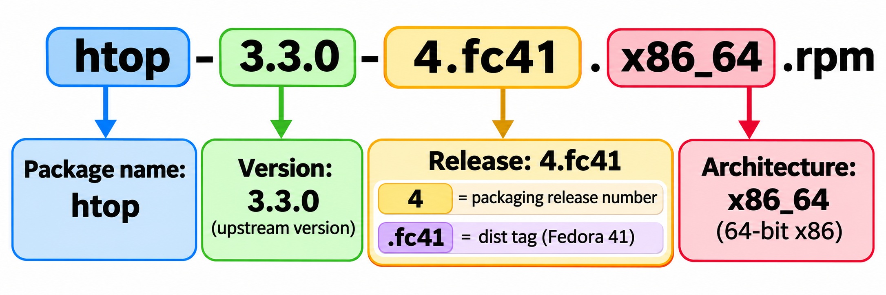

# RPM — RPM Package Manager

> All examples in this document were captured on **Fedora 41**. To follow along, start a container and install the tools used in the examples:
>
> ```
> docker run -it fedora:41 bash
> dnf install -y file cpio
> dnf download bash htop
> ```
>
> This installs `file` (for inspecting file types) and `cpio` (an archiving tool needed to extract `.rpm` payloads), then downloads the `bash` and `htop` `.rpm` files used throughout the examples. `rpm` is already preinstalled.

`rpm` is the **low-level** package management tool used in Red Hat-based Linux distributions such as Fedora, RHEL, CentOS, Rocky Linux, and AlmaLinux. It is also used in SUSE-based distributions such as openSUSE and SLES. It installs, removes, upgrades, and queries individual `.rpm` packages that are already on the local filesystem.

The name RPM originally stood for **Red Hat Package Manager** but was later redefined as the recursive acronym **RPM Package Manager**.

Because `rpm` is a low-level tool, it does **not** resolve dependencies automatically. If a package depends on other packages that are not yet installed, `rpm` will refuse to install it and list the missing dependencies. For day-to-day use, a higher-level tool like `dnf` (Red Hat family) or `zypper` (SUSE family) is preferred because it handles dependency resolution, downloads, and repository access on your behalf.

Most Red Hat-based and SUSE-based systems come with `rpm` preinstalled. You can check its version with:

```
$ rpm --version
RPM version 4.20.1
```

Basic syntax:

```
$ rpm [<option> ...] <command>
```


## RPM Naming Convention

RPM filenames have **four fields** — hyphens separate the first three, and a dot separates the last two:

```
<name>-<version>-<release>.<architecture>.rpm
```

| Field            | Description |
|------------------|-------------|
| `<name>`         | The package name (e.g., `htop`, `bash`). |
| `<version>`      | The upstream software version. |
| `<release>`      | The packaging build number, often with a **dist tag** appended (see below). |
| `<architecture>` | The target hardware (e.g., `x86_64`, `aarch64`, `noarch`). |

For example:



Common architecture values: `x86_64` (64-bit Intel/AMD), `aarch64` (64-bit ARM), `i686` (32-bit Intel), `noarch` (architecture-independent, e.g., scripts or documentation).

### The Dist Tag

In the example above, the Release field is `4.fc41`. The `.fc41` suffix is called the **dist tag**. It identifies which distribution the package was built for (e.g., `.fc41` = Fedora 41, `.el9` = RHEL 9). The dist tag is part of the Release field, not a separate field. In the spec file, the packager writes:

```
Release: 4%{?dist}
```

The build system expands `%{?dist}` to the appropriate tag (`.fc41`, `.el9`, etc.). This is mandatory in Fedora and common across all RPM-based distributions.

> **Comparison with `.deb`:** `.deb` filenames use **underscores** as separators and encode the Debian revision inside the version field (e.g., `htop_3.3.0-4build1_amd64.deb`). RPM filenames use **hyphens** and keep `Version` and `Release` as two genuinely separate header fields.


## The `.rpm` Package File

An `.rpm` package is a binary archive containing four sections.


You can verify the format with the `file` command:

```
$ file bash-5.2.32-1.fc41.x86_64.rpm
bash-5.2.32-1.fc41.x86_64.rpm: RPM v3.0 bin i386/x86_64 bash-5.2.32-1.fc41
```

The four sections of an `.rpm` file are:

- **Lead** — A 96-byte header at the start of the file. It contains a magic number and basic identification (package name, format version). The lead exists for historical reasons and is largely superseded by the header, but `rpm` still checks its magic number to confirm the file is a valid `.rpm` package.

- **Signature** — Cryptographic signatures and checksums that verify the integrity and authenticity of the package. When you import a GPG key and install a package, `rpm` checks this section to ensure the package has not been tampered with.

- **Header** — The main metadata section. It contains everything `rpm` needs to know about the package:

    | Field          | Purpose                                                      |
    |----------------|--------------------------------------------------------------|
    | Name           | Package name.                                                |
    | Version        | Package version and release number.                          |
    | Description    | Human-readable description of the package.                   |
    | Dependencies   | Required packages (`Requires`), provided capabilities (`Provides`), and conflicts (`Conflicts`). |
    | File list      | Every file the package installs, with paths, permissions, and checksums. |
    | Scriptlets     | Scripts executed during install, upgrade, or removal (see below). |
    | Changelog      | History of changes to the package.                           |

- **Payload** — A compressed `cpio` archive containing the actual files to be installed. The directory structure inside the archive mirrors the filesystem layout (e.g., `/usr/bin/`, `/etc/`). The payload is typically compressed with `gzip`, `xz`, or `zstd`.

### Scriptlets

RPM packages can include **scriptlets** — shell scripts that run at specific points during installation, upgrade, or removal:

| Scriptlet  | When It Runs                              |
|------------|-------------------------------------------|
| `%pre`     | **Before** installation or upgrade.       |
| `%post`    | **After** installation or upgrade.        |
| `%preun`   | **Before** removal or upgrade.            |
| `%postun`  | **After** removal or upgrade.             |
| `%pretrans`  | At the very start of a transaction, before any packages are installed or removed.  |
| `%posttrans` | At the very end of a transaction, after all packages have been installed or removed. |

These are the RPM equivalent of Debian's `preinst`, `postinst`, `prerm`, and `postrm` scripts.

### Inspecting a Package

You can examine an `.rpm` file before installing it by combining the `-q` (query) flag with `-p` (query an uninstalled package file):

| Command                           | Purpose                                             |
|-----------------------------------|-----------------------------------------------------|
| `rpm -qpi <package.rpm>`          | Displays metadata (name, version, description).     |
| `rpm -qpl <package.rpm>`          | Lists the files inside the package.                 |
| `rpm -qpR <package.rpm>`          | Lists the package's dependencies.                   |
| `rpm -qp --scripts <package.rpm>` | Shows the scriptlets included in the package.       |

Example metadata output:

```
$ rpm -qpi bash-5.2.32-1.fc41.x86_64.rpm

Name        : bash
Version     : 5.2.32
Release     : 1.fc41
Architecture: x86_64
Install Date: (not installed)
Group       : Unspecified
Size        : 8546628
License     : GPL-3.0-or-later
Signature   : RSA/SHA256, Mon Aug 12 16:14:36 2024, Key ID d0622462e99d6ad1
Source RPM  : bash-5.2.32-1.fc41.src.rpm
Build Date  : Mon Aug 12 12:41:08 2024
Build Host  : buildhw-x86-05.iad2.fedoraproject.org
Packager    : Fedora Project
Vendor      : Fedora Project
URL         : https://www.gnu.org/software/bash
Summary     : The GNU Bourne Again shell
Description :
The GNU Bourne Again shell (Bash) is a shell or command language
interpreter that is compatible with the Bourne shell (sh). Bash
incorporates useful features from the Korn shell (ksh) and the C shell
(csh). Most sh scripts can be run by bash without modification.
```

You can also view the scriptlets included in the package:

```
$ rpm -qp --scripts bash-5.2.32-1.fc41.x86_64.rpm

postinstall scriptlet (using <lua>):
nl        = '\n'
sh        = '/bin/sh'..nl
bash      = '/bin/bash'..nl
f = io.open('/etc/shells', 'a+')
if f then
  local shells = nl..f:read('*all')..nl
  if not shells:find(nl..sh) then f:write(sh) end
  if not shells:find(nl..bash) then f:write(bash) end
  f:close()
end
...
```

This `postinstall` scriptlet adds `/bin/bash` and `/bin/sh` to `/etc/shells` after installation — a real-world example of the `%post` scriptlet described above.

### Extracting an `.rpm` Package

Unlike `.deb` files (which use `ar`), `.rpm` files require `rpm2cpio` to convert the payload to a `cpio` stream, then `cpio` to extract:

```
$ rpm2cpio bash-5.2.32-1.fc41.x86_64.rpm | cpio -idmv

./etc/skel/.bash_logout
./etc/skel/.bash_profile
./etc/skel/.bashrc
./usr/bin/alias
./usr/bin/bash
./usr/bin/bashbug
./usr/bin/bashbug-64
./usr/bin/bg
./usr/bin/cd
./usr/bin/command
./usr/bin/fc
./usr/bin/fg
...
```

Notice the configuration files under `./etc/` — these are the files RPM tracks specially during upgrades (see [Configuration File Handling](#configuration-file-handling)).

The flags mean: `-i` (extract), `-d` (create directories), `-m` (preserve modification times), `-v` (verbose).


## Installing a Package

To install a local `.rpm` package:

```
$ sudo rpm -i <package.rpm>
```

Add `-v` (verbose) and `-h` (hash marks for progress) for more readable output:

```
$ sudo rpm -ivh <package.rpm>
```

`rpm` only works with **local** `.rpm` files. If the package is hosted online, you must download it first:

```
$ dnf download htop
$ sudo rpm -ivh htop-3.3.0-4.fc41.x86_64.rpm
```

If any dependencies are missing, `rpm` will refuse to install and list what is needed:

```
error: Failed dependencies:
    libhwloc.so.15()(64bit) is needed by htop-3.3.0-4.fc41.x86_64
    libnl-3.so.200()(64bit) is needed by htop-3.3.0-4.fc41.x86_64
    libnl-3.so.200(libnl_3)(64bit) is needed by htop-3.3.0-4.fc41.x86_64
    libnl-genl-3.so.200()(64bit) is needed by htop-3.3.0-4.fc41.x86_64
    libnl-genl-3.so.200(libnl_3)(64bit) is needed by htop-3.3.0-4.fc41.x86_64
```

`rpm` itself cannot resolve this — you need a higher-level tool like [DNF](05_dnf.md) or `zypper` to download and install the missing dependencies automatically. Both accept a local `.rpm` file, resolve its dependencies from configured repositories, and install everything in one step:

```
# On Red Hat-based systems
$ sudo dnf install <package.rpm>

# On SUSE-based systems
$ sudo zypper install <package.rpm>
```

> **Warning:** You can force installation with `--nodeps` to skip dependency checks, but this often results in broken software and is strongly discouraged.

### Installation Process

The installation of an `.rpm` package follows these steps:

1. **Dependency check** — Verifies that all required packages and libraries are present.
2. **Pre-installation scriptlet** — Executes `%pre`, if present.
3. **File installation** — Extracts the payload and places files in their target locations.
4. **Post-installation scriptlet** — Executes `%post` to complete setup (e.g., running `ldconfig`, enabling services).


## Upgrading a Package

RPM distinguishes between **installing** and **upgrading**:

| Command                     | Behavior                                                         |
|-----------------------------|------------------------------------------------------------------|
| `rpm -i <package.rpm>`      | Installs the package. Fails if it is already installed.          |
| `rpm -U <package.rpm>`      | Upgrades the package if installed, or installs it if not.        |
| `rpm -F <package.rpm>`      | Upgrades the package **only** if an older version is installed.  |

In practice, `rpm -Uvh` is the most commonly used command because it works whether the package is new or already installed:

```
$ sudo rpm -Uvh <package.rpm>
```

During an upgrade, RPM performs these steps:

1. Installs the new version of the package.
2. Removes the old version's files (except modified configuration files — see below).
3. Runs the appropriate scriptlets (`%pre`, `%post`, `%preun`, `%postun`).


## Configuration File Handling

RPM is careful with configuration files during upgrades. Unlike `dpkg` (which prompts you interactively), RPM handles conflicts **silently** based on whether you or the package maintainer changed the file:

| Your Copy | New Package Version | What RPM Does |
|---|---|---|
| Unchanged | Unchanged | Replaces with the new version (nothing to do). |
| Unchanged | Updated   | Replaces with the new version silently. |
| Modified  | Unchanged | Keeps your modified version. |
| Modified  | Updated   | Keeps your modified version and saves the new one as **`.rpmnew`**. |

```
/etc/example.conf          ← your modified version (kept)
/etc/example.conf.rpmnew   ← new version from the package
```

If you have **not** modified the file but it was replaced, RPM saves the old one with an **`.rpmsave`** extension.

> **Comparison with dpkg:** `dpkg` prompts you interactively to choose between your version and the package maintainer's version. RPM never prompts — it silently preserves your changes and leaves the new version as `.rpmnew` for you to merge manually.


## Removing a Package

To remove an installed package:

```
$ sudo rpm -e <package-name>
```

Note that `-e` (erase) takes a **package name**, not a `.rpm` file path. If other packages depend on the one being removed, `rpm` will refuse and list the dependent packages:

```
$ sudo rpm -e glibc
error: Failed dependencies:
    glibc is needed by (installed) bash-5.2.32-1.fc41.x86_64
    ...
```

Unlike `dpkg`, RPM does not have a separate "purge" option. Removing a package removes all its files, but modified configuration files may be saved with an `.rpmsave` extension so you do not lose custom settings.


## Querying Packages

The `-q` flag is the gateway to all RPM queries. By default it queries the local RPM database of installed packages.

### Querying Installed Packages

| Command                             | Purpose                                                  |
|-------------------------------------|----------------------------------------------------------|
| `rpm -qa`                           | Lists **all** installed packages.                        |
| `rpm -qi <package-name>`            | Shows detailed metadata for an installed package.        |
| `rpm -ql <package-name>`            | Lists all files installed by the package.                |
| `rpm -qc <package-name>`            | Lists only configuration files.                          |
| `rpm -qd <package-name>`            | Lists only documentation files.                          |
| `rpm -qR <package-name>`            | Lists dependencies (what the package requires).          |
| `rpm -q --scripts <package-name>`   | Shows the package's scriptlets.                          |
| `rpm -qf /path/to/file`             | Finds which package owns a specific file.                |
| `rpm -q --changelog <package-name>` | Shows the package's changelog.                           |

### Example Queries

```
# Check if a package is installed
$ rpm -q bash
bash-5.2.32-1.fc41.x86_64

# List all files installed by a package
$ rpm -ql bash
/etc/skel/.bash_logout
/etc/skel/.bash_profile
/etc/skel/.bashrc
/usr/bin/alias
/usr/bin/bash
/usr/bin/bashbug
/usr/bin/bashbug-64
...

# List only configuration files
$ rpm -qc bash
/etc/skel/.bash_logout
/etc/skel/.bash_profile
/etc/skel/.bashrc

# Find which package owns a file
$ rpm -qf /usr/bin/bash
bash-5.2.32-1.fc41.x86_64
```


## Verifying Packages

RPM can verify the integrity of installed packages by comparing the current state of files on disk against the metadata stored in the RPM database:

```
$ rpm -V <package-name>
```

If everything is intact, the command produces no output:

```
$ rpm -V htop
$
```

If files have been modified, RPM reports each change with a 9-character code. For example, if a configuration file has been edited:

```
S.5....T.  /etc/htoprc
```

Each character position represents a specific check:

| Position | Char | Meaning                          |
|----------|------|----------------------------------|
| 1        | `S`  | File **s**ize changed.           |
| 2        | `M`  | **M**ode (permissions) changed.  |
| 3        | `5`  | MD**5** checksum changed.        |
| 4        | `D`  | **D**evice number changed.       |
| 5        | `L`  | Sym**l**ink path changed.        |
| 6        | `U`  | **U**ser ownership changed.      |
| 7        | `G`  | **G**roup ownership changed.     |
| 8        | `T`  | Modification **t**ime changed.   |
| 9        | `P`  | Ca**p**abilities changed.        |

A `.` means that check passed. In the example above, `S.5....T.` means the file's size, checksum, and modification time have changed — it was likely edited by the user.

To verify all installed packages:

```
$ rpm -Va
```


## The RPM Database

RPM maintains a local database at `/var/lib/rpm/` that tracks every installed package, its files, metadata, and dependencies. All query and verification commands read from this database.

```
$ ls /var/lib/rpm/
rpmdb.sqlite
rpmdb.sqlite-shm
rpmdb.sqlite-wal
```

> **Note:** Older RPM versions (before RPM 4.16) used Berkeley DB files (`Packages`, `Basenames`, `Name`, etc.). Modern RPM uses a single **SQLite** database, which is more reliable and easier to recover.

If the database becomes corrupted (e.g., after a crash during installation), you can rebuild it:

```
$ sudo rpm --rebuilddb
```

This regenerates the database indexes from the installed package headers. It does not remove or install any packages.

---

**Previous**: [← APT](03_apt.md) · **Next**: [DNF →](05_dnf.md)
